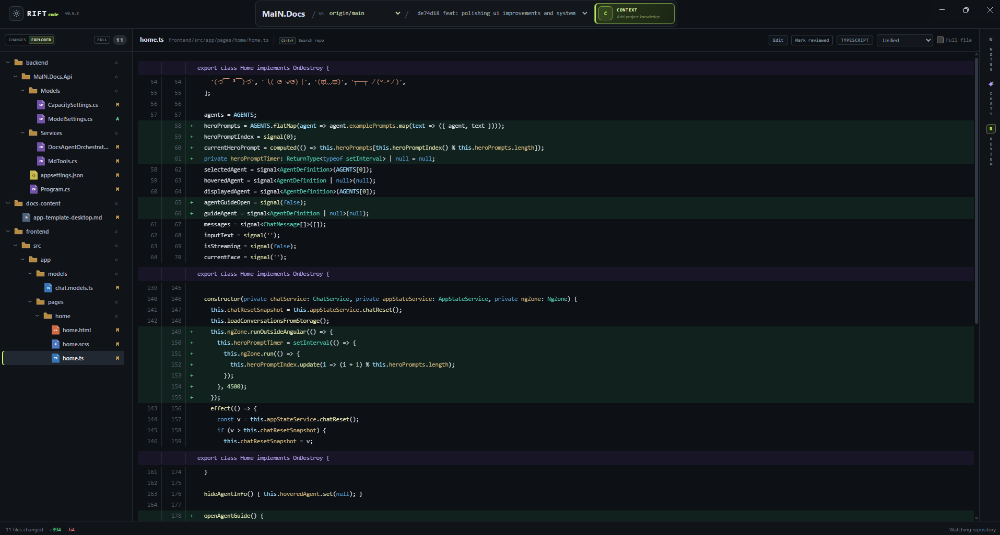

# Rift

> A visual, AI-native workspace for understanding, reviewing, and refining code changes.

[](./version.json)
[](#getting-started)
[](./LICENSE)

AI can produce code faster than developers can responsibly review it. Rift is built for the new bottleneck: making sense of a growing stream of generated and human-written changes before they become part of the codebase.



## Getting Started

Rift currently supports Windows and macOS. The installer builds the desktop application locally, so **Node.js 24 or newer** and Git are required.

These are **source-build installers**, not downloads of signed application releases. The commands below follow `main`; an unmerged feature candidate requires the exact pinned source commands in its pull request. The software-factory execution support limits below are narrower than desktop Review support.

### Windows

Run in PowerShell:

```powershell
irm https://raw.githubusercontent.com/wisedev-pstach/RiftCode/main/install.ps1 | iex
```

Open a new terminal, then launch Rift from any repository:

```powershell
rift .
```

You can also pass a repository path:

```powershell
rift C:\path\to\repository
```

### macOS

Run in a shell:

```sh
curl -fsSL https://raw.githubusercontent.com/wisedev-pstach/RiftCode/main/install.sh | sh
```

Ensure `~/.local/bin` is on your `PATH`, then launch Rift:

```sh
rift .
```

### AI Agents

Rift discovers supported coding agents installed on your machine. Install and authenticate at least one to use the unified AI terminal:

- [OpenCode](https://opencode.ai/)
- [Claude Code](https://docs.anthropic.com/en/docs/claude-code/overview)
- [Codex CLI](https://developers.openai.com/codex/cli/) (interactive terminal)

Use the compact **Notes / Agent / Review** rail to open either native provider workspace. Agent supports new or resumed sessions; Review has its own retained session and scoped review brief. Notes and source insertion are **Enter-free**: they do not start a provider, execute a prompt or answer native approvals. **Run review** and **Send & track** are separate explicit submissions; follow-up questions belong in the provider's native prompt. Ctrl/Cmd-click `file:line` output to open source. Sessions survive workflow/view switches, not repository changes or app shutdown. Saved Rift notes/history are preserved; native resume uses provider-owned sessions scoped to this repository. See [terminal setup, safety and verification](docs/TERMINAL-AI.md).

Repository browsing, diffs, notes, review tracking, and editing work without an AI agent.

## Software factory (0.9.0)

Opening a repository offers **Creation** or **Review**. Review keeps the existing Notes / Agent / Review rail and native provider terminals. Switching workflows retains mounted terminal sessions and drafts; it does not submit a prompt, approve a plan or stop a running factory.

Creation separates the work into explicit stages:

1. Write requirements, or explicitly request provider-generated questions and requirements.
2. Edit an architecture, supporting diagram and dependency-ordered task plan. Diagram preview supports a bounded flowchart subset; unsupported syntax remains visible as source.
3. Define exact native verification commands and approve the saved plan, provider configuration/execution permissions and bounded attempt/time budget. **Approve does not Start.**
4. Start a sequential implementation → native verification → bounded repair loop. Model output is never a passing test receipt.
5. Review each queued task when ready. Saved patches, prior source, command receipts and supporting documents remain tied to that immutable revision, even when later tasks edit the same file. Accepting a review does not commit or merge anything.

Planning documents, diagrams, receipts and review evidence live in app-owned local storage **outside the checkout**, not as PR files. Five canonical portable skills are bundled as ordinary `SKILL.md` files; adapters embed their instructions rather than modifying provider homes. Manual planning remains available without a provider. Stop waits for native execution cleanup; interrupted runs are not automatically resumed.

**Factory execution is capability-gated, not universal CLI support:**

- Claude uses a supported native executable/version and explicit startup/configuration consent. Codex additionally requires main-owned, exact-version capability evidence from bounded consented probes.
- OpenCode execution remains Blocked/manual without trusted exact-version evidence; its read-only planning transport is not supported. This does not remove the existing interactive OpenCode terminal.
- Default factory discovery accepts native binaries, not npm shell/JavaScript shims. Such launchers require a separately validated native Node/entrypoint locator; otherwise use the existing interactive terminal.
- Windows factory execution is currently Blocked because process-tree cleanup is not verified. Existing desktop Review/Agent functionality remains separate. macOS authenticated factory acceptance has not been exercised by the Linux fixture tests.
- Provider configuration and approved commands run under the native OS account and may access the network. Filtered environment variables and read-only planning intent are **not an OS sandbox**. Model calls may incur charges under the selected provider's account.

See [runtime and support boundaries](docs/FACTORY-RUNTIME.md), [native IPC/lifecycle](docs/FACTORY-NATIVE.md), [workbench and evidence UI](docs/FACTORY-UI.md), and [retained workflow entry](docs/FACTORY-ENTRY.md). Synthetic UI/provider fixtures establish the behaviors described in their evidence, not authenticated-provider or native-platform acceptance.

## Why Rift

The AI era changed the shape of software development. Writing code is cheaper, but understanding code is not.

Large diffs arrive quickly. Generated changes often look plausible while hiding subtle regressions, unnecessary complexity, or assumptions that do not fit the surrounding system. Traditional diff viewers show what changed, and chat windows can discuss code, but the developer is left to connect those two worlds manually.

Rift brings the review surface and the AI conversation together:

- **See the complete change** in a focused, syntax-highlighted diff instead of reviewing code through chat fragments.
- **Navigate by structure** with a changed-files tree or the full repository explorer.
- **Build review state** by marking files or entire folders reviewed and keeping notes attached to exact lines.
- **Ask with real context** by sending selected lines, files, review notes, and project references to a coding agent.
- **Stay in control** by inspecting the agent's tool activity and editing the working tree directly when a fix is needed.

Rift does not try to replace engineering judgment. It gives that judgment a workspace designed for the volume and velocity of AI-assisted development.

## What You Can Do

| Review | Understand | Act |
| --- | --- | --- |
| Compare the working tree, branches, and commits | Browse changed files as a tree or open the full repository | Edit changed files directly from the diff |
| Switch between unified and side-by-side diffs | Search file names and repository contents | Insert selected code into Claude, OpenCode or Codex |
| Expand to full-file context | Attach project details, links, files, images, and directories | Resume provider sessions for the current repository |
| Mark files and folders reviewed | Add notes anchored to precise changed lines | Prepare comparison context with Review changes |

Additional details include light and dark themes, per-repository review sessions, changed-region navigation, syntax-aware rendering, and live repository refresh.

## Review Workflow

1. Open a repository with `rift .`.
2. Choose the working tree, a branch comparison, or a commit.
3. Walk the changed-file tree and inspect each diff in context.
4. Mark files or complete folders reviewed as you go.
5. Select suspicious lines to add a note or ask an AI coding agent.
6. Apply or make fixes, refresh the comparison, and review what changed again.

Rift is a local desktop application, not a hosted repository service. For AI features it invokes supported agent CLIs; selected code and context may be sent to model providers according to the configuration, authentication, and privacy terms of those tools.

## Development

```sh
git clone https://github.com/wisedev-pstach/RiftCode.git
cd RiftCode
npm ci
npm run dev
```

Useful commands:

```sh
npm run typecheck  # TypeScript and Angular template checks
npm run build      # Production Electron build
npm run package    # Package for the current platform
```

Rift is built with Electron, Angular, TypeScript, and electron-vite.

## License

Rift is available under the [MIT License](./LICENSE).
