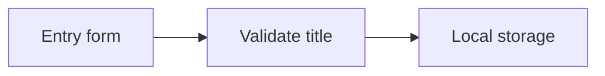

# Software factory — implemented Angular workbench

## Integration contract

`FactoryWorkbench` is a real standalone Angular component against the frozen `FactoryApi`. It does not install a bridge, select repositories, replace the existing review UI, create a terminal session, or own the application's mode chooser.

```ts
import {FactoryWorkbench} from './factory-workbench.component';
// Add FactoryWorkbench to the parent's standalone imports.
// Pass a stable FactoryApi object, not a newly constructed object per change detection.
```

```html
<rift-factory-workbench
  [api]="factoryApi"
  [root]="canonicalRepositoryRoot"
  [repositoryLabel]="repositoryLabel"
  (exit)="onFactoryExit($event)"
/>
```

- Required input: `api: FactoryApi` (the main/preload factory bridge).
- Optional input: `root: string`; use the canonical native repository root. Changing it invalidates in-flight UI results immediately. Without it, repository identity is derived from loaded state.
- Optional input: `repositoryLabel: string`, display only; not path authority.
- Output: `exit: EventEmitter<'review' | 'home'>`. Workspace emits `home`; Review mode emits `review`. Parent routes these to its actual existing surfaces. This component deliberately does not implement a second Review mode.
- `FactoryDocuments`, selector `rift-factory-documents`, is imported by the workbench automatically. Its `content` / `kind` inputs provide safe read-only document and diagram views.
- Styles are encapsulated inline component styles, intentionally compatible with the existing template-inlining Vite plugin. No shared stylesheet or package dependency change is required. Light theme inherits an ancestor `[data-theme="light"]` or `.light`; dark is default. Parent provides a height-constrained flex/grid container with `min-height: 0`.

## Implemented behavior

Requirements, Architecture, Plan, Run and Review queue are independent navigation steps. Manual title/requirements/architecture/diagram editors work without a provider. Tasks expose description, acceptance criteria, dependency IDs, allowed paths and verification command IDs. Commands expose the absolute executable, relative cwd, timeout, stdout/stderr limits and environment-key allowlist. Argument editing uses **one JSON string per line**, preserving empty arguments and exact string boundaries; invalid JSON is retained visibly and blocks saving. These are argument arrays, not shell strings. Native validation remains authoritative for command and task policy.

Save draft, Approve plan and Start run are distinct bridge actions. Unsaved drafts block approval, generation and execution. Edits, repository/API changes and new draft revisions clear permission grants. Approval sends only the known `FactoryProviderConsent` values plus saved draft revision, provider, attempt budget and run duration. The separate execution-context/exact-command checkbox is a UI prerequisite, not an invented API field. Attempt limits are 1–5 and run bounds 100–3,600,000 ms; the native service validates again.

**Provider availability is explanatory, not a permission to execute and not an approval deadlock.** An unavailable or unprobed status, including `supported:false`, does not prevent an explicitly consented Generate/Approve call: the native service performs capability checks and may return Blocked. No capability trust field is sent by the renderer. Missing providers still allow manual planning. Windows, native trust, missing tooling and unsupported provider failures are displayed as backend errors/status; there is no renderer-side success fallback or provider substitution.

Consent text calls out provider model charges, installed provider configuration, native OS/network execution and workspace writes. There is no blanket tool auto-approval, credential handling or prompt answering. This UI does not claim that provider configuration or verification commands are sandboxed.

The initial `load()` is read-only. While a run is `running` or `stopping`, a single timer polls every 1.5 seconds after each completed load; no overlapping polling requests are scheduled. Starting, stopping and state-changing calls cancel pending polling, and polling is cancelled on component destruction. Loading does not restart or mark the backend's live run interrupted. Stop awaits the actual `api.stop()` result: while deferred, the UI says it is waiting for native confirmation and retains the last confirmed run state. Native stop/cleanup errors leave that state intact rather than pretending completion.

API/root context generations, state-request versions, revision-request versions and artifact-request versions reject obsolete responses. A root/API change clears selected evidence and grants; late save/load/revision/artifact/stop results cannot populate the new UI context. Failed native saves retain unsaved draft content. Parent should still change `root` as soon as repository context changes; native scope enforcement is a second boundary, not something the renderer replaces.

## Review and evidence boundaries

- The queue separates Unreviewed, Accepted and Changes requested. Execution does not wait for acceptance, and opening the queue does not stop a run.
- A selected revision is fetched with `readRevision(id)`, never a live current-Git patch request.
- Changed paths open their saved patch artifact IDs. The patch view colors text-only addition/deletion/hunk lines and retains escaped untrusted text. Before/after source artifacts are available when recorded. Binary content and mode transitions are explicit, rather than an invented textual comparison.
- Checks display recorded receipt IDs, task revision, source fingerprints, executable, exact JSON argv, cwd, approval/policy IDs, timestamps, reason, exit/signal, cleanup, byte counts, stdout/stderr and optional native error. Missing receipts are explicitly not evidence. No renderer-generated test receipts or progress percentages exist.
- Documents, Diagrams and All artifacts are separate evidence tabs. All immutable artifact IDs remain accessible even when they are not in the named document categories. Workspace-level artifacts are also inspectable before any review exists.
- `readArtifact(id)` is scoped to the workspace and selected revision's IDs. Returned scope/ID must match and text is bounded to 1 MiB. Native storage isolation and immutable retention remain native-service responsibilities; this UI labels local supporting artifacts **not in PR**, not ordinary untracked Git files.
- Accept / Request changes call only `api.review()`. They do not stage, commit, merge or accept other revisions. Rework calls only `api.rework(id)`, is disabled while running/stopping, and displays native rejection honestly. Existing evidence is never overwritten by a UI-generated replacement revision.

## Safe documents and diagrams

Markdown is presented as labeled read-only source, preserving content rather than interpreting HTML or clickable links. All code, logs, sources and diagram labels use Angular text bindings. No arbitrary SVG/HTML injection, trust bypass, remote renderer, CDN or external-resource link is used.

Diagram preview supports a deliberately bounded declarative subset:



Supported headers: `flowchart` / `graph` with `LR`, `TD` or `TB`; plain ID/rectangular-label nodes; single `-->` edges per line; optional trailing semicolon; `%%` comment lines. Preview caps: 12,000 source characters, 24 nodes, 48 edges; node IDs 32 characters and labels 80. SVG nodes/edges derive from the submitted source, using an automatic bounded layout. LR uses a three-column wrap; TD/TB uses a vertical arrangement. Long visible labels are shortened with full text retained in source/title. This is **not full Mermaid**: subgraphs, styles/classes, click handlers, links, directives, other shapes, edge labels/chains, self-loop edges and other diagram families are unsupported. Any unsupported syntax shows the original source and an explanation; it does not silently show a partial diagram or a static prototype image.

## Isolated verification (no parent App edits)

From repository root, run the owned Vite fixture server in one terminal:

```sh
npx vite --config tests/factoryui-harness/vite.config.ts
```

Then:

```sh
npx ngc -p tests/factoryui-harness/tsconfig.json --noEmit
npx playwright test -c tests/factoryui-harness/playwright.config.ts
```

Only port **4189**, loopback, is used. Strict port allocation prevents taking another server's port. This harness boots the actual component with Angular and a synthetic `FactoryApi`; it does not call the App, Electron IPC, provider, Git, credentials or an external application API. The persistent page label says **Synthetic API fixture · actual Angular component · no native execution**. Synthetic receipt content is explicitly labeled. These are UI behavior tests, not backend/provider execution evidence. The harness configuration points at the installed Chromium `chromium-1248`; the originally supplied `chromium-1208` path was absent on this host. No download or dependency edit was necessary.

Verified result: **16 Playwright tests passed** (the previous 14 plus two independent-review regressions), focused strict-template Angular compilation passed. The revision-switch regression first failed with a stale artifact spinner still visible after the old read resolved; opening a revision now clears that obsolete loading state while request fencing preserves a newer pending artifact's spinner. The command-allocation regression first failed with duplicate `check2` IDs after add/remove/add; allocation now skips occupied IDs, including manually renamed gaps, without renumbering existing commands or changing task command references. Each new browser test was observed RED before its corresponding minimal production fix, then GREEN. Logs, exit codes, per-stage SHA-256 source manifests and aggregated results are saved in `/opt/data/output/riftcode/software-factory/ui-review-fixes/`. Coverage includes fresh consent gating with unprobed provider status, separate approval/run, deferred Stop, stop cleanup failure, bounded live polling without restart, failed save draft retention, invalid argument editing, task scope/criteria persistence, blocked native generation/rework, two unaccepted revisions, patch/source/log/Markdown escaping, actual supported diagram preview and unsupported-source fallback, stale load/save/artifact rejection on context/revision changes, workspace artifacts and exact exit values.

Actual-component screenshots and JSON gates:

`/opt/data/output/riftcode/software-factory/angular-ui/`

- 1440×900 and 1024×768, dark/light: **4 matrix cases**.
- **32 PNGs**, eight states per case: requirements, architecture, editable plan, queued run, immutable patch, receipts, local document and safe diagram.
- **32 viewport/footer states**, **72 footer-button visibility and center-hit gates**.
- **0 JavaScript page errors; 0 external HTTP requests**, asserted on every test. Local Vite module/HMR traffic is allowed, not counted as external traffic.
- `verification.json` aggregates the four `*-gates.json` files. The historical static-prototype screenshots in `ux/` are not used as runtime proof.

No full production App/package build was performed by this UI task. Actual parent-App routing, preload/main integration and authenticated native-provider execution must be verified by their owners; the isolated harness does not establish those claims.
